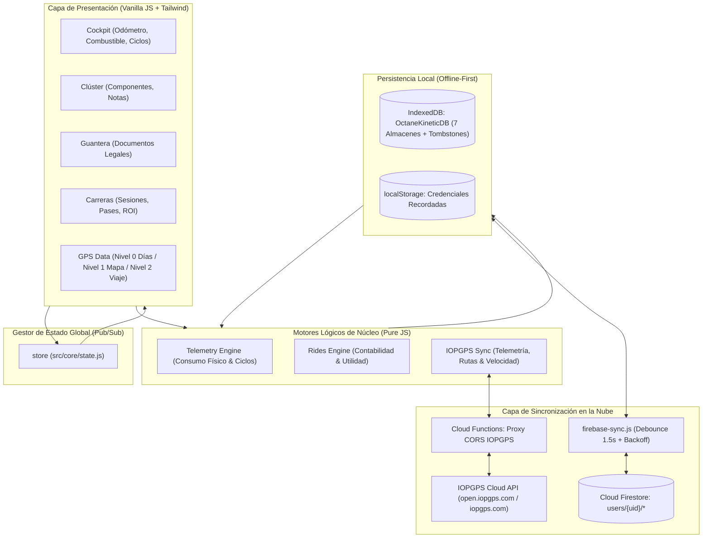
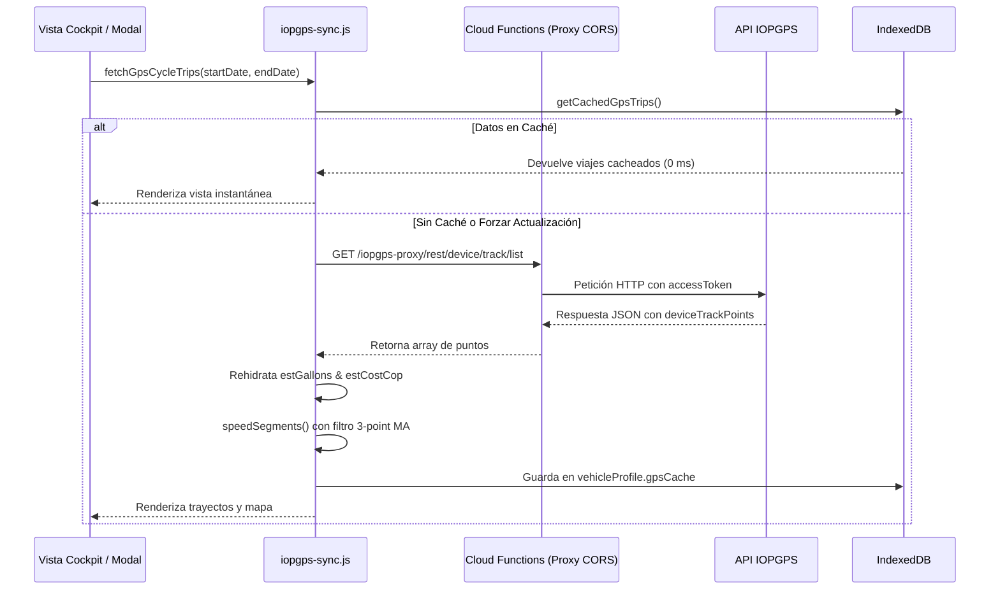

# OCTANE // KINETIC — Arquitectura de Software y Especificación Técnica

Este documento describe la arquitectura interna, los flujos de datos y los patrones de diseño implementados en **OCTANE // KINETIC**. Está destinado a desarrolladores y agentes de IA para garantizar la integridad técnica y la mantenibilidad del sistema.

---

## 1. Diagrama General de Arquitectura

---

## 2. Capa de Almacenamiento Local (IndexedDB: `OctaneKineticDB`)

El almacenamiento local es la **fuente primaria de la verdad** (`Source of Truth`). Si la red falla o Firebase está deshabilitado, la aplicación funciona de forma completamente autónoma.

### 2.1. Versión y Almacenes (Versión 3)
La base de datos se inicializa en [`src/core/db-local.js`](file:///c:/Users/jperaltac/OneDrive%20-%20Universidad%20del%20Norte/Juan%20Camilo/Proyectos/OCTANE/src/core/db-local.js) con 7 almacenes de objetos principales y 1 almacén de lápidas (*tombstones*):

| Almacén | Clave Primaria (`keyPath`) | Índices Secundarios | Propósito |
| :--- | :--- | :--- | :--- |
| `vehicle_profile` | `id` | — | Perfil del chasis, capacidad de tanque, benchmark de rendimiento, configuración GPS y caché telemática. |
| `telemetry_logs` | `id` | `date`, `odometer_reading`, `updatedAt` | Lecturas manuales del odómetro y registros de tanqueadas. |
| `maintenance_items`| `id` | `category` | Componentes mecánicos, intervalos de servicio y kilómetros de reemplazo. |
| `free_notes` | `id` | `date`, `isPinned`, `categoryTag` | Bitácora técnica libre con etiquetas y fijación. |
| `legal_docs` | `id` | `docType` | Documentación reglamentaria (SOAT, RTM, extintor) y fechas de vencimiento. |
| `ride_sessions` | `id` | `date` | Turnos de conducción en plataformas, ingresos brutos y gastos. |
| `platform_passes` | `id` | `platform`, `startDate` | Pases y comisiones prepagadas de plataformas. |
| `deleted_records` | `key` | — | **Tombstones**: Registra registros eliminados localmente para propagar el borrado hacia Cloud Firestore. |

---

## 3. Capa de Sincronización Nube (`src/core/firebase-sync.js`)

La sincronización con **Cloud Firestore** es transparente, reactiva y tolerante a fallos:

1. **Debounce de 1.5 Segundos**: Cada escritura en IndexedDB invoca `scheduleDebouncedSync()`. Los cambios se acumulan durante 1.500 ms antes de enviar la transacción en lote a Firestore, reduciendo lecturas/escrituras innecesarias.
2. **Reintentos con Backoff Exponencial**: En caso de error de red, el sistema programa reintentos automáticos a los `5s`, `30s` y `120s`.
3. **Resolución de Borrados mediante Tombstones**: Cuando un registro se elimina localmente, se guarda un marcador en `deleted_records`. Durante la sincronización, Firestore elimina el documento remoto correspondiente antes de limpiar la lápida local.
4. **Degradación Elegante**: Si las variables de entorno de Firebase (`VITE_FIREBASE_API_KEY`, etc.) están ausentes, `isFirebaseConfigured()` devuelve `false` y el estado de sincronización se marca como `'offline'`, garantizando que la aplicación jamás lance errores no controlados.

---

## 4. Pipeline Telemático GPS (`src/core/iopgps-sync.js`)

El subsistema de GPS procesa datos de localización de alta frecuencia desde los rastreadores IOPGPS:

### 4.1. Filtro de Velocidad y Suavizado Anti-Jitter
Para evitar que el ruido del sensor GPS genere micro-segmentos alternados ("cuentas de collar"), se aplica un promedio móvil ponderado de 3 puntos:
$$\bar{v}_i = \frac{v_{i-1} + 2v_i + v_{i+1}}{4}$$

### 4.2. Clasificación Cromática de 5 Niveles
* `crawl` ($<12\text{ km/h}$): Rojo Carmesí (`#EF4444`, $4.0\text{ px}$)
* `slow` ($12-24\text{ km/h}$): Naranja Rojizo (`#F97316`, $3.5\text{ px}$)
* `moderate` ($24-38\text{ km/h}$): Ámbar Octane (`#F59E0B`, $3.2\text{ px}$)
* `fluid` ($38-52\text{ km/h}$): Amarillo Cálido (`#FACC15`, $2.8\text{ px}$)
* `fast` ($\ge 52\text{ km/h}$): Amarillo Neón (`#FFFF00`, $2.5\text{ px}$)

---

## 5. Instrumento Cartográfico (`src/components/gps/gps-route-map.js`)

* **Carga Bajo Demanda**: Leaflet 1.9.4 se carga asíncronamente desde CDN únicamente cuando se abre una vista de mapa, manteniendo el bundle principal ultraligero.
* **Proyección SVG Instantánea**: Mientras los azulejos de mapa descargan o si el dispositivo está sin red, se dibuja de inmediato un trazado vectorial SVG reactivo del recorrido.
* **Base Map Sin Clave API**: Usa *Esri World Dark Gray Base* con fallback transparente hacia *OpenStreetMap Dark*.
* **Atenuación Táctica Contextual**: Al seleccionar un trayecto, las demás rutas del día se atenúan a opacidad 0.10 en color `#26262B`, y la cámara ejecuta un reencuadre lineal nítido (`fitBounds`) en 250 ms.
* **Control de Nitidez**: Configurado con `zoomAnimationThreshold: 2`, `zoomSnap: 1` y CSS `image-rendering: -webkit-optimize-contrast;` para erradicar cualquier desenfoque durante zooms.

---

## 6. Service Worker y Protocolo PWA (`public/sw.js`)

1. **Estrategia Stale-While-Revalidate**: Sirve el shell de la aplicación instantáneamente desde caché mientras busca actualizaciones en segundo plano.
2. **Control de Versiones**: Cache versionada bajo identificador `octane-v1.0.8`. Al publicar una nueva versión, los cachés antiguos se depuran automáticamente en el evento `activate`.
3. **Bypass Estricto de APIs Dinámicas**: Peticiones a dominios de Firebase (`firestore.googleapis.com`, `identitytoolkit.googleapis.com`), APIs de Google y el proxy de IOPGPS se excluyen de la caché del Service Worker para garantizar datos frescos.
