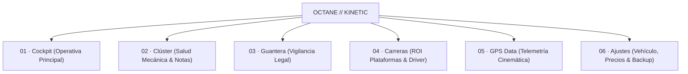

# OCTANE // KINETIC

> **Sistema Operativo Vehicular de Precisión** — Progressive Web App (PWA) de arquitectura *offline-first*, inspirada en los principios de diseño industrial de Dieter Rams (Braun), la estética táctil de Teenage Engineering y la relojería contemporánea.

[](https://octane-86001.web.app)
[](https://nodejs.org/)
[](https://vitejs.dev/)
[](https://firebase.google.com/)
[](https://tailwindcss.com/)

---

## 1. Visión & Filosofía

OCTANE no es una hoja de cálculo con gráficos ni un dashboard corporativo de flota. Es un **instrumento automotriz de precisión** diseñado bajo una estricta filosofía de:

1. **Silencio Verbal y Elegancia Industrial**: Cero párrafos largos explicativos, cero etiquetas de depuración ruidosas y cero cajas anidadas dentro de cajas. La jerarquía se construye mediante el contraste estricto entre **Micro-Labels** monoespaciados y **Macro-Valores** numéricos.
2. **Arquitectura Offline-First**: La base de datos primaria vive 100% en el dispositivo del usuario mediante **IndexedDB (7 almacenes relacionales)**. Toda la aplicación es completamente operativa en parqueaderos subterráneos, zonas rurales o sin cobertura celular.
3. **Sincronización en la Nube No Bloqueante**: Cuando hay conexión, se activa una sincronización silenciosa bidireccional con **Cloud Firestore**, debounced a 1.5s, con resolución determinista mediante *tombstones* para borrados.
4. **Verdad Física y Mecánica**: Modelado termodinámico del consumo, detección de régimen severo (trayectos fríos $<8\text{ min}$), telemetría cinemática de aceleraciones/frenadas y análisis de degradación de componentes mecánicos.

---

## 2. Módulos del Sistema



### 2.1. Cockpit
* **Odómetro Drum-Counter**: Contador mecánico analógico de tambores partidos con tipografía monoespaciada de alta legibilidad y badge de ritmo diario (`KM/DÍA`).
* **Lente de Combustible Dinámico**: Medidor de combustible con cálculo físico de litros disponibles, reserva crítica y autonomía en kilómetros.
* **Métricas Maestras**: Rendimiento real ponderado (`KM/GAL`, `L/100`), costo exacto por kilómetro (`$ COP/KM`), autonomía total y gasto mensual de combustible.
* **Línea de Tiempo de Ciclos**: Desglose visual por ciclo de tanqueada, con inspección y edición de lecturas intermedias y repostajes.

### 2.2. Clúster
* **Diales de Componentes**: Arcos circulares de desgaste con catálogo de 12 íconos vectoriales (aceite, filtros, frenos, bujías, neumáticos, batería, etc.) y cálculo de vida útil restante en kilómetros o días.
* **Tablero de Notas Técnicas**: Bitácora libre con categorización dinámica (`Mecánica`, `Repuesto`, `Ruido`, `General`), anclaje (`pin`), fecha retroactiva y kilometraje editable.

### 2.3. Guantera
* **Semáforo Legal**: Alertas automáticas para SOAT, Revisión Técnico-Mecánica (RTM), Extintor, Seguro Todo Riesgo y Tarjeta de Operación.
* **Conteo Regresivo**: Indicador directo de días restantes antes de expiración con advertencia de 30 días.

### 2.4. Carreras (Módulo Conductor)
* **Contabilidad Operativa**: Registro de sesiones de conducción en plataformas (Uber, DiDi, InDrive).
* **Métricas de Rendimiento**: Horas efectivas, costo de pases, consumo de gasolina atribuido y Utilidad Neta Real por hora (`$ COP/H`).

### 2.5. GPS DATA (Telemetría Cinemática IOPGPS)
* **Lienzo Cartográfico Nivel 0 / 1 / 2**:
  * **Nivel 0 (Días)**: Lista compacta con firma cartográfica vectorial (glifo SVG del recorrido real).
  * **Nivel 1 (Día Completo)**: Mapa Leaflet con todos los trayectos del día sobre base oscura Esri World Dark Gray sin API key.
  * **Nivel 2 (Viaje Enfocado)**: Enfoque con atenuación profunda al 10% de las rutas no seleccionadas, halo exterior y pines tácticos A/B.
* **Paleta de Flujo de 5 Niveles**:
  * Rojo Carmesí (`#EF4444`): Congestión severa / trancón ($<12\text{ km/h}$).
  * Naranja Rojizo (`#F97316`): Tráfico lento ($12-24\text{ km/h}$).
  * Ámbar Octane (`#F59E0B`): Flujo urbano normal ($24-38\text{ km/h}$).
  * Amarillo Cálido (`#FACC15`): Flujo ágil ($38-52\text{ km/h}$).
  * Amarillo Eléctrico (`#FFFF00`): Crucero rápido / autopista ($\ge 52\text{ km/h}$).
* **Filtro Cinemático Anti-Jitter**: Suavizado de velocidad por promedio ponderado de 3 puntos (`(prev + curr*2 + next)/4`) para garantizar cintas continuas sin efecto de "cuentas de collar".

---

## 3. Pila Tecnológica & Arquitectura

* **Frontend**: Vanilla JavaScript (ES Modules nativos, cero frameworks pesados, 60 fps).
* **Estilos**: Tailwind CSS 3.4 + Variables CSS industriales en `src/style/tokens.css` (Modo Carbón y Modo Papel).
* **Bundler & Dev Server**: Vite 5.3+.
* **Almacenamiento Local**: IndexedDB nativo (Base de datos: `OctaneKineticDB`, versión `3`, 7 stores).
* **Cartografía**: Leaflet 1.9.4 on-demand + Esri World Dark Gray Base (Fallback OpenStreetMap Dark).
* **Nube & Autenticación**: Firebase 10 (Firebase Auth Google Provider, Cloud Firestore, Firebase Hosting).
* **Backend Bridge**: Firebase Cloud Functions (Node.js 20) como proxy CORS seguro hacia la API IOPGPS.
* **Service Worker**: PWA con estrategia *Stale-While-Revalidate* (`public/sw.js`).

---

## 4. Instalación & Desarrollo Local

### 4.1. Prerrequisitos
* Node.js $\ge 18.0.0$
* npm $\ge 9.0.0$

### 4.2. Pasos de Inicialización
```bash
# 1. Clonar el repositorio
git clone <URL_DEL_REPOSITORIO>
cd OCTANE

# 2. Instalar dependencias del frontend
npm install

# 3. Configurar variables de entorno
cp .env.example .env
# Editar .env con tus credenciales de Firebase (ver sección 5)

# 4. Iniciar servidor de desarrollo
npm run dev
```

---

## 5. Configuración de Firebase & Variables de Entorno

El archivo `.env` en la raíz define la conexión a Firebase. Debe tener la siguiente estructura:

```ini
VITE_FIREBASE_API_KEY=AIzaSy...
VITE_FIREBASE_AUTH_DOMAIN=octane-86001.firebaseapp.com
VITE_FIREBASE_PROJECT_ID=octane-86001
VITE_FIREBASE_STORAGE_BUCKET=octane-86001.firebasestorage.app
VITE_FIREBASE_MESSAGING_SENDER_ID=123456789012
VITE_FIREBASE_APP_ID=1:123456789012:web:abcdef123456
```

> [!IMPORTANT]
> Si `.env` no existe o sus valores están vacíos, OCTANE opera de forma segura en **modo local offline**, sin lanzar excepciones y guardando todos los datos en IndexedDB.

---

## 6. Pruebas Automatizadas

El proyecto cuenta con suites de pruebas automatizadas que validan la integridad matemática del motor, la sincronización, los almacenes IndexedDB (mediante `fake-indexeddb`) y las reglas de diseño:

```bash
# Ejecutar todas las pruebas del núcleo (12 suites)
node tests/test-core.js

# Validar el modal de trayectos GPS y reglas de diseño
node tests/test-gps-trips-modal.js

# Validar el motor de carreras y ROI
node tests/test-rides-engine.js
```

---

## 7. Build y Despliegue a Producción

El proyecto se despliega en Firebase Hosting bajo el identificador oficial **`octane-86001`**:

```bash
# 1. Compilar para producción (Vite genera dist/)
npm run build

# 2. Desplegar hosting a Firebase
npm run deploy
# Equivalente a: npx -y firebase-tools@latest deploy --only hosting
```

URL de producción: **[https://octane-86001.web.app](https://octane-86001.web.app)**

---

## 8. Estructura del Repositorio

```text
OCTANE/
├── .env.example                # Plantilla de variables de entorno
├── .firebaserc                 # Proyecto Firebase por defecto (octane-86001)
├── firebase.json               # Configuración de Hosting, Firestore y Rewrites
├── firestore.rules             # Reglas de seguridad declarativas por usuario
├── index.html                  # Shell HTML PWA
├── package.json                # Dependencias y scripts
├── tailwind.config.js          # Configuración de temas y colores
├── vite.config.js              # Configuración del empaquetador Vite
│
├── functions/                  # Cloud Functions (Proxy CORS IOPGPS)
│   ├── index.js
│   └── package.json
│
├── public/                     # Activos estáticos servidos tal cual
│   ├── favicon.ico
│   ├── manifest.webmanifest    # Manifiesto de PWA instalable
│   ├── sw.js                   # Service Worker (Cache versioning)
│   └── icons/                  # Íconos de aplicación
│
├── src/
│   ├── main.js                 # Punto de entrada de la aplicación
│   ├── assets/                 # SVGs de vehículos e ilustraciones
│   ├── components/             # Componentes UI reutilizables
│   │   ├── cluster/            # Tablero de notas, catálogo de íconos
│   │   ├── dialogs/            # Modales de confirmación e inputs limpios
│   │   ├── gps/                # gps-route-map.js (Instrumento Leaflet)
│   │   ├── modals/             # Modales de lecturas, tanqueadas, GPS, etc.
│   │   └── rides/              # Componentes de carreras y turnos
│   ├── core/                   # Motores lógicos desacoplados de la UI
│   │   ├── db-local.js         # IndexedDB (7 stores + tombstones)
│   │   ├── firebase-sync.js    # Sincronización Cloud Firestore
│   │   ├── iopgps-sync.js      # Motor telemático IOPGPS + Clasificador de velocidad
│   │   ├── state.js            # Store global reactivo Pub/Sub
│   │   └── telemetry-engine.js # Motor físico de consumo de combustible
│   ├── style/
│   │   └── tokens.css          # Variables de diseño (Modo Carbón / Modo Papel)
│   └── views/                  # Vistas principales (Cockpit, Clúster, Guantera, etc.)
│
└── tests/                      # Suites de pruebas automatizadas
    ├── test-core.js
    ├── test-gps-trips-modal.js
    └── test-rides-engine.js
```

---

## 9. Lineamientos Obligatorios para Agentes y Desarrolladores

Cualquier modificación debe respetar estrictamente:
* [AGENTS.md](file:///c:/Users/jperaltac/OneDrive%20-%20Universidad%20del%20Norte/Juan%20Camilo/Proyectos/OCTANE/AGENTS.md)
* [DESIGN_GUIDELINES.md](file:///c:/Users/jperaltac/OneDrive%20-%20Universidad%20del%20Norte/Juan%20Camilo/Proyectos/OCTANE/DESIGN_GUIDELINES.md)
* [ARCHITECTURE.md](file:///c:/Users/jperaltac/OneDrive%20-%20Universidad%20del%20Norte/Juan%20Camilo/Proyectos/OCTANE/ARCHITECTURE.md)
